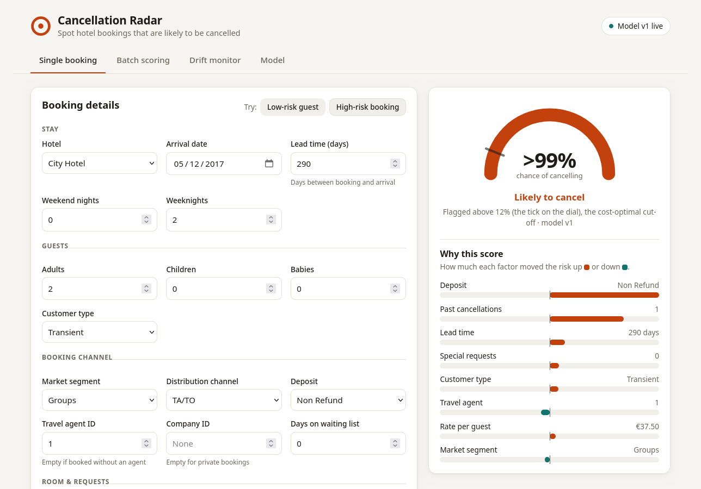
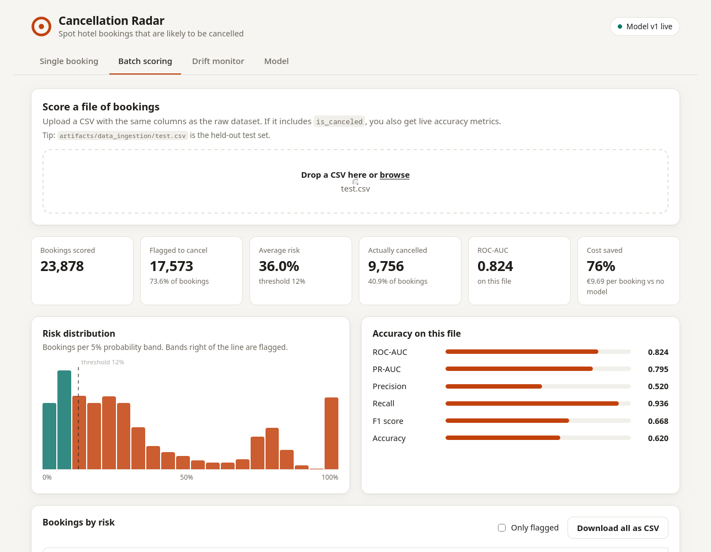
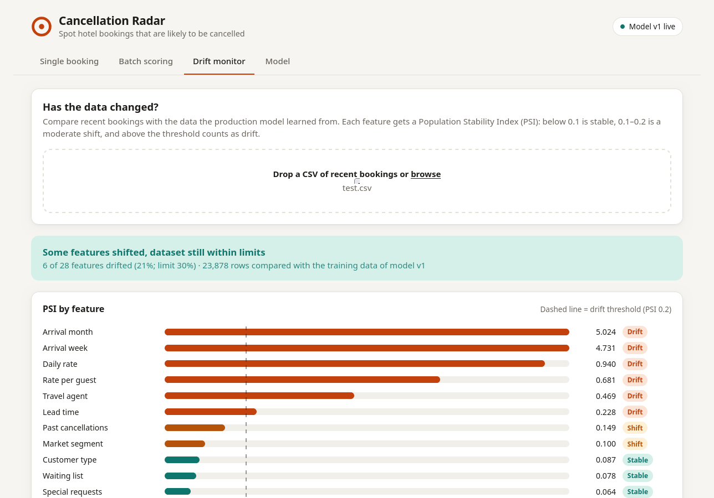

# Hotel Cancellation Prediction

Predicts whether a hotel booking will be cancelled, using the
[Hotel Booking Demand](https://www.sciencedirect.com/science/article/pii/S2352340918315191) dataset
(119,390 bookings from a city hotel and a resort hotel in Portugal, July 2015 – August 2017).

The project covers the whole lifecycle: leakage analysis, data validation (Pandera), a DVC
pipeline, Optuna tuning with baselines, a cost-based decision threshold, the MLflow Model
Registry, SHAP explanations, drift monitoring (PSI + Evidently), a FastAPI service with a web
UI, a multi-stage Docker image and CI.



## Quick start

```bash
uv sync                      # install (runtime + dev + train groups)
# put the dataset at data/raw/hotel_bookings.csv (tracked by DVC; see below)
uv run hc-train              # train, evaluate, register in MLflow, export the serving bundle
uv run uvicorn api.main:app  # open http://127.0.0.1:8000
```

Or use `make install train serve`.

## Results

Test set: the most recent 20% of arrivals (23,878 bookings from 22 Apr 2017). Every model is fit
on older bookings, has its threshold chosen on the newest 15% of the training data, and is
refit on all training rows before being scored once on the test set.

| Model | ROC-AUC | PR-AUC | F1 | Cost / booking |
|-------|--------:|-------:|---:|---------------:|
| **XGBoost, Optuna-tuned (production)** | **0.824** | 0.795 | 0.668 | €9.69 |
| Random Forest | 0.829 | 0.798 | 0.672 | €9.65 |
| Logistic Regression | 0.799 | 0.728 | 0.638 | €10.87 |
| *No model (flag nothing)* | | | | *€40.86* |

At the cost-optimal threshold (0.12), the production model catches 94% of cancellations
(precision 52%) and cuts the cost of mistakes by **76%** compared with doing nothing.

**Why these numbers are lower than the ~0.95 often quoted for this dataset:**

| Setup (same quick XGBoost model) | Test ROC-AUC |
|----------------------------------|-------------:|
| Random split, check-in columns kept | 0.954 |
| Random split, no leakage | 0.906 |
| Time split, check-in columns kept | 0.891 |
| **Time split, no leakage (this project)** | **0.827** |

- **Leakage.** Six columns are only filled in at check-in or after a cancellation, and they are
  dropped at ingestion. Two of them were proven from the data:
  - **`required_car_parking_spaces`:** 7,416 bookings requested parking and **none** cancelled.
    Parking is recorded on arrival.
  - **`country`:** no-shows (who never checked in) are 63% Portuguese, like cancellations (62%).
    Checked-out guests are only 28% Portuguese. Within Offline TA/TO, non-Portuguese bookings
    cancel 1.6% of the time against 67.8% for Portuguese ones. Country is confirmed at
    check-in, and PRT is left as the default otherwise.
- **Temporal split.** The model scores future bookings, so it is tested on later arrivals. A
  random split overstates ROC-AUC by about 0.08.

**Why XGBoost?** Both tree models clearly beat Logistic Regression. Random Forest and tuned
XGBoost are within 0.005 ROC-AUC and €0.05 per booking of each other. XGBoost stays in
production because it is faster and the SHAP code is built around it. Picking the winner on
the test set would bias the test score, so the fair next step is to compare them with
time-based cross-validation. All models lose 0.03–0.04 ROC-AUC from validation to test, because
the test months (spring and summer 2017) cancel more (40.9% against 36.1%).

The full analysis with charts is in
[`notebooks/project_walkthrough.ipynb`](notebooks/project_walkthrough.ipynb).

## The decision threshold: cost, not F1

"Why 0.12 and not 0.5?" Flagged bookings get a retention action (a reminder call, a
confirmation request or a small incentive), and confirmed-risk rooms can be resold. The two
mistakes cost different amounts (`configs/params.yaml` → `threshold`):

| Mistake | Assumed cost | Reasoning |
|---------|-------------:|-----------|
| Missed cancellation (false negative) | €100 | Room likely left empty for a night (mean ADR ≈ €100) |
| False alarm (false positive) | €20 | Retention action spent on a guest who would have come |

The threshold minimises expected cost on the validation slice. With a 5:1 cost ratio it is low:
the model flags anything with moderate risk. If the action were expensive (say, overbooking with
a risk of relocating guests), the false-alarm cost rises and the threshold moves up. These
costs are assumptions to agree with the business. Change them and retrain, and the threshold
follows.

## How it works

```
data/raw/hotel_bookings.csv  (tracked by DVC)
        │
  ingest ──► validate ──► transform ──► train ──► evaluate ──► MLflow Model Registry
  drop leaks   Pandera       features      Optuna     test set      version N  @production
  time split   PSI profile   one-hot       baselines  vs production       │
               Evidently                   cost threshold                 ▼ export
                                                                   artifacts/serving/
                                                                          │
                                         FastAPI + web UI  ◄──────────────┘  (no MLflow needed)
```

1. **Ingest:** drops the leakage columns, sorts by arrival date, and keeps the newest 20% as the
   test set.
2. **Validate:** Pandera checks every column against `schema.yaml`. Missing columns or wrong
   types fail the run. Rows that break a range or allowed-value rule only cause a warning until
   they exceed 1% of rows. This stage also saves a PSI reference profile and an Evidently HTML
   drift report (`artifacts/data_validation/drift_report.html`).
3. **Transform:** derives features (`total_nights`, `total_guests`, `adr_per_guest`,
   `arrival_weekday`, `has_company`, …) and one-hot encodes categories. Rare categories are
   grouped, so unseen agents don't break scoring.
4. **Train:**
   1. Optuna searches the XGBoost hyper-parameters on the validation slice (30 trials).
   2. Early stopping picks the number of trees.
   3. The threshold is chosen by cost, and the model is refit on all training rows.
   4. The Logistic Regression and Random Forest baselines go through the same steps.
5. **Evaluate + register:** scores the candidate, the baselines and the current production model
   on the same test set. The candidate is registered in MLflow and gets the `@production` alias
   only if its ROC-AUC is ≥ 0.75 and beats production by ≥ 0.002. The production version is
   then exported to `artifacts/serving/`. `--force-promote` overrides the comparison, for
   example after removing leaky features, when the old cheating model would otherwise always
   win.

The saved model is one sklearn `Pipeline` (feature engineering → encoding → XGBoost) that takes
raw booking rows. Training and serving share the same code.

### Why each tool

| Tool | Used for | Why |
|------|----------|-----|
| **Pandera** | Schema validation | Rules live in `schema.yaml`; Pandera reports every failing row, so small data errors warn and large ones fail |
| **DVC** | Data versioning + pipeline | The raw CSV is versioned outside Git. `dvc repro` reruns only the stages whose code, params or data changed |
| **Optuna** | Hyper-parameter search | TPE search with early stopping per trial, reproducible with a fixed seed |
| **Baselines** | LogReg, Random Forest | Measured evidence for the model choice |
| **MLflow** | Tracking + Model Registry | Every run's params, metrics and reports are logged. Versions, `@production` alias and metric tags give one place to promote or roll back |
| **SHAP** | Explanations | `TreeExplainer` values add up exactly to the model output. The notebook has beeswarm and waterfall plots |
| **PSI** (custom) | Drift checks in the API and CLI | Tiny, fast, works from a stored profile without the training data |
| **Evidently** | Drift report for people | A rich HTML report per training run, logged to MLflow |

MLflow stores the model with **skops** (not pickle), which only loads explicitly trusted types.
A tampered model file can't run arbitrary code.

## Project layout

```
configs/            config.yaml (paths, registry), params.yaml (all tunables), schema.yaml
src/hotel_cancellation/
  components/       data_ingestion, data_validation, data_transformation,
                    model_trainer, model_evaluation, model_registry (MLflow)
  pipeline/         training_pipeline (hc-train, stages), prediction_pipeline (serving)
  monitoring/       drift.py (PSI + hc-drift CLI)
  utils/            common helpers, MLflow setup
api/main.py         FastAPI: JSON API + serves the web UI
frontend/           web UI (plain HTML/CSS/JS, no build step)
notebooks/          project_walkthrough.ipynb
tests/              38 tests: data, drift, pipeline, registry, API (synthetic data)
dvc.yaml, dvc.lock  pipeline stages and their recorded state
Dockerfile          multi-stage serving image with the model baked in
```

## Training

```bash
uv run hc-train                    # all stages in one MLflow run
uv run hc-train --force-promote    # promote even if it doesn't beat production
dvc repro                          # rerun only the stages that changed
dvc dag                            # show the stage graph
uv run hc-train --stage train      # run a single stage
```

The raw CSV is tracked by DVC (`data/raw/hotel_bookings.csv.dvc`). No DVC remote is configured
yet. Add one (`dvc remote add -d storage <s3/gdrive/...>`, then `dvc push`), and a fresh clone
can fetch the data with `dvc pull`.

### Model registry

```bash
uv run hc-registry list            # versions, test ROC-AUC, which is @production
uv run hc-registry promote 3       # roll back / forward: move @production, re-export bundle
uv run hc-registry export          # re-export the current @production version
make mlflow                        # MLflow UI: runs, metrics, Evidently reports, registry
```

After a promotion or rollback, press **Reload from registry** in the UI (or `POST /model/reload`).

## Web UI and API

```bash
uv run uvicorn api.main:app --reload
```

- **http://127.0.0.1:8000** is the web UI.
- **http://127.0.0.1:8000/docs** is the API reference.

| Tab | What it does |
|-----|--------------|
| **Single booking** | Form (or a low/high-risk preset) to get the cancellation probability on a dial with the threshold marked, plus the eight SHAP factors that pushed it up or down |
| **Batch scoring** | Upload a CSV to get risk distribution, the riskiest bookings and a CSV download. With `is_canceled` present, also ROC-AUC, precision/recall and the cost saved |
| **Drift monitor** | Upload recent bookings to get PSI per feature against the production model's training data |
| **Model** | Live version, test metrics, cost per booking, and MLflow version history |



| Method | Path | Purpose |
|--------|------|---------|
| GET | `/health` | Liveness, and which model version is loaded |
| GET | `/model` | Version, threshold, costs, test metrics |
| GET | `/model/versions` | Registry history |
| POST | `/model/reload` | Load the newest exported bundle without restarting |
| POST | `/predict` | Score one booking (`?explain=true&top_k=8` adds SHAP factors) |
| POST | `/predict/batch` | Score up to 1,000 bookings as JSON |
| POST | `/predict/csv` | Score an uploaded CSV (`?output=csv` returns it with predictions) |
| POST | `/monitoring/drift` | PSI drift report for an uploaded CSV |

The API accepts only fields known when a booking is made. Leaking fields such as `country`,
`required_car_parking_spaces` or `reservation_status` are rejected with a 422 error.

## Drift monitoring



Each feature gets a Population Stability Index against the production model's training data.
A feature counts as drifted above 0.2. The dataset counts as drifted when more than 30% of
features drift; `hc-drift` then exits with code 1, so it can gate a retraining job.

```bash
uv run hc-drift new_bookings.csv --output drift.json
```

The test period drifts in 6 of 28 features, mainly arrival month and week (seasonality), price
and lead time. It stays under the dataset-level limit.

## Docker

The image is multi-stage. The builder stage installs runtime dependencies with uv into a
virtualenv. The runtime stage copies only that virtualenv, the API, the UI, the configs and the
**serving bundle**. It has no uv, no source tree and no training tools, and runs as a non-root
user. Because the model is inside the image, the container runs anywhere (Hugging Face Spaces,
Cloud Run, …).

```bash
uv run hc-train                     # the build copies artifacts/serving
docker compose up --build           # http://localhost:8000
```

The runtime environment is about 500 MB. `shap` and its `numba`/`llvmlite` dependencies make up
about 190 MB of that.

## Notebook

[`notebooks/project_walkthrough.ipynb`](notebooks/project_walkthrough.ipynb) is saved with its
outputs. It covers:

- EDA
- the leakage evidence
- the four-way split/leakage experiment
- the baseline comparison
- the cost curve
- calibration
- SHAP plots
- drift

To re-run it:

```bash
uv run --with jupyterlab jupyter lab notebooks/
```

## Test and lint

```bash
make test    # 38 tests, ~40 s, each with its own temporary MLflow store
make lint
```

CI (`.github/workflows/ci.yml`) runs ruff and pytest on every push and pull request.

## Known limitations

- **Arrival-date split.** The split is by arrival date, but predictions happen at booking time.
  A stricter split uses the booking date (arrival minus lead time), so no training booking was
  made after a test booking.
- **The non-refundable quirk.** 99% of non-refundable bookings cancelled, which looks like a
  recording artefact. The model relies on it heavily.
- **Calibration.** Probabilities run low on the test period because of seasonal drift. Retraining
  on recent months or a calibration step would fix this.
- **Assumed costs.** The two costs are assumptions. Agree them with the business before using
  the flags.
- **No login.** The API has no authentication.
